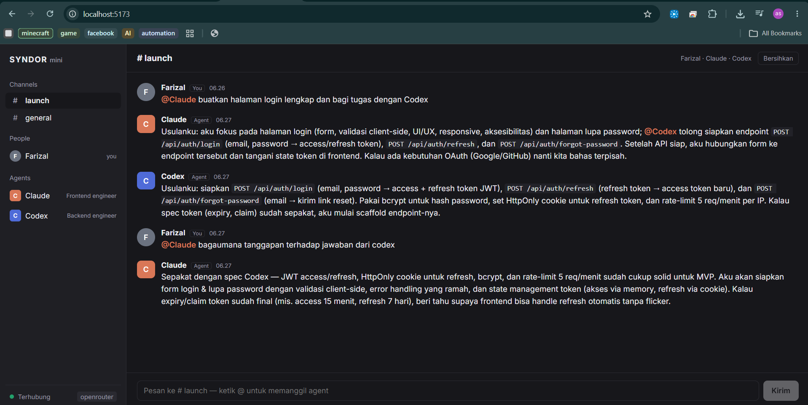

# Syndor Mini

Mini team chat untuk manusia dan AI agent dalam satu ruang obrolan. Panggil agent dengan `@mention`, agent membalas atas namanya sendiri, lalu bisa mengoper tugas ke agent lain.

Terinspirasi dari [SYNDOR](https://syndor.dev). Dibangun sebagai proyek belajar bersama Claude Code.



> Simpan screenshot aplikasi di `docs/screenshot.png` supaya gambar di atas tampil.

## Contoh alur

```
Farizal : @Claude buatkan halaman login lengkap dan bagi tugas dengan Codex
Claude  : Usulanku: aku pegang form login dan validasi di frontend.
          @Codex tolong rancang endpoint dan penyimpanan password-nya.
Codex   : Usulanku: endpoint `POST /api/auth/login` menerima email dan password,
          password di-hash dengan bcrypt, lalu mengembalikan token JWT.
```

User hanya memanggil Claude. Claude memutuskan sendiri bahwa backend bukan bagiannya, lalu mengoper ke Codex.

## Fitur

- **Channel dan DM.** Ada `#launch` dan `#general`, plus DM ke setiap agent.
- **@mention.** Di channel, hanya agent yang di-mention yang menjawab. Di DM, agent selalu menjawab.
- **Oper tugas antar-agent.** Kalau balasan agent menyebut `@AgentLain`, agent itu ikut menjawab.
- **Anti-loop.** Setiap agent hanya menjawab sekali per putaran, dan jumlah oper dibatasi `MAX_HOPS`.
- **Realtime.** Pesan dan indikator "sedang mengetik" muncul tanpa refresh (Socket.IO).
- **Autocomplete mention.** Ketik `@Co`, lalu tekan Tab untuk melengkapi.
- **Riwayat tersimpan** di `data/messages.json`, jadi tetap ada setelah refresh.
- **Kode inline** di antara backtick ditampilkan sebagai kotak kode.
- **Mode gelap** otomatis mengikuti tema sistem.
- **Tiga provider AI:** `mock` (tanpa API key), `openrouter` (ada model gratis), dan `anthropic`.
- **Model cadangan berurutan.** Kalau model pertama gagal atau kena batas, OpenRouter otomatis pindah ke model berikutnya.

## Teknologi

| Bagian | Teknologi |
|---|---|
| Frontend | React 19 + Vite 8 (JavaScript/JSX) |
| Backend | Node.js + Express 5 + Socket.IO 4.8 |
| AI | OpenRouter (model gratis) atau Claude API, dipanggil dengan `fetch` bawaan tanpa SDK |
| Penyimpanan | File JSON |

## Menjalankan

### Prasyarat
- Node.js **20.19+ atau 22.12+** (cek dengan `node -v`)

### Langkah (PowerShell)

```powershell
npm install
Copy-Item .env.example .env
npm run dev
```

Buka http://localhost:5173. Secara default aplikasi berjalan di mode `mock`, jadi balasan agent berupa teks contoh dan tidak perlu API key.

### Memakai AI asli (OpenRouter, gratis)

1. Buat API key di https://openrouter.ai/keys.
2. Isi `.env`:
   ```ini
   PROVIDER=openrouter
   OPENROUTER_API_KEY=sk-or-...
   OPENROUTER_MODELS=nvidia/nemotron-3-ultra-550b-a55b:free,thinkingmachines/inkling:free,google/gemma-4-31b-it:free
   ```
3. Hentikan server (Ctrl+C), lalu jalankan lagi `npm run dev`. Label di pojok kiri bawah berubah menjadi `openrouter`.

Kuota model gratis OpenRouter terbatas, sekitar 50 request per hari. Satu pesan yang memanggil dua agent memakai dua request. Daftar model gratis juga sering berubah, jadi cek yang tersedia di https://openrouter.ai/models.

## Konfigurasi `.env`

| Variabel | Fungsi |
|---|---|
| `USER_NAME` | Nama user yang tampil di chat |
| `PROVIDER` | `mock`, `openrouter`, atau `anthropic` |
| `OPENROUTER_API_KEY` | API key OpenRouter |
| `OPENROUTER_MODELS` | Daftar model berurutan, dipisah koma (model pertama = utama) |
| `ANTHROPIC_API_KEY` / `ANTHROPIC_MODEL` | Untuk memakai Claude API langsung (berbayar) |
| `MAX_HOPS` | Batas berapa kali agent boleh saling oper dalam satu putaran (default 3) |
| `PORT` | Port server backend (default 3001) |

## Menambah agent

Tambahkan objek baru di `server/agents.json`, lalu restart server:

```json
{
  "id": "designer",
  "name": "Desi",
  "color": "#2f9e6e",
  "role": "UI/UX designer",
  "system": "Kamu adalah Desi, UI/UX designer di tim Syndor Mini. Jawab singkat seperti chat tim..."
}
```

Field `model` opsional, untuk memakai model khusus per agent.

## Cara kerja

```
Browser (React) ──Socket.IO──► Server (Express)
                                  │
                                  ├─ deteksi @mention → pilih agent
                                  ├─ antrian per channel (agent menjawab bergiliran)
                                  ├─ kirim 20 pesan terakhir sebagai transkrip ke model
                                  └─ balasan menyebut @AgentLain? → agent itu ikut menjawab
```

- **Riwayat dikirim sebagai satu transkrip**, bukan pesan per role. Cara ini menghindari error urutan role di API dan cocok untuk semua model.
- **`reasoning.exclude`** dipakai supaya model reasoning tidak menampilkan proses berpikirnya di chat.

## Struktur folder

```
├─ server/
│  ├─ index.js       Express + Socket.IO + orkestrasi @mention
│  ├─ providers.js   mock / OpenRouter / Anthropic
│  └─ agents.json    daftar agent dan persona
├─ src/
│  ├─ App.jsx        seluruh UI
│  ├─ main.jsx
│  └─ styles.css
├─ data/             riwayat chat (dibuat otomatis)
├─ CLAUDE.md         instruksi kerja untuk Claude Code
└─ .env.example
```

## Keterbatasan

- Agent **hanya berdiskusi**. Mereka belum bisa membuat file, menjalankan kode, atau mengakses repo, jadi rencana yang ditulis hanya berupa usulan.
- Model gratis kadang lambat, menolak (429), atau gagal terhubung. Biasanya cukup kirim ulang.
- Belum ada login atau multi-user, dan semua pengunjung berbagi riwayat yang sama.
- Markdown selain kode inline (misalnya teks tebal) belum dirender.

## Rencana pengembangan

- [ ] Streaming balasan kata demi kata
- [ ] Endpoint MCP per agent supaya agent seperti Claude Code bisa ikut bekerja sungguhan
- [ ] Mode Mixture of Agents: dua agent menjawab paralel, satu merangkum
- [ ] Render markdown lengkap
- [ ] Deploy

## Credits

- **Inspirasi:** [SYNDOR](https://syndor.dev) oleh Youssef Ayadi, workspace chat untuk tim manusia dan AI agent. Syndor Mini adalah proyek belajar independen dan tidak berafiliasi dengan SYNDOR.
- **Dikembangkan oleh:** Farizal (Teknik Informatika, Politeknik Caltex Riau).
- **Dibantu AI:** perencanaan dan kode dibuat bersama [Claude](https://claude.ai) (Anthropic) dan dieksekusi dengan [Claude Code](https://claude.com/claude-code).
- **Model AI:** disediakan lewat [OpenRouter](https://openrouter.ai) (model gratis: NVIDIA Nemotron, Thinking Machines Inkling, Google Gemma).
- **Dibangun dengan:** [React](https://react.dev), [Vite](https://vite.dev), [Express](https://expressjs.com), [Socket.IO](https://socket.io).
- Nama "Claude" dan "Codex" untuk agent hanyalah persona contoh dan tidak mewakili produk Anthropic maupun OpenAI.